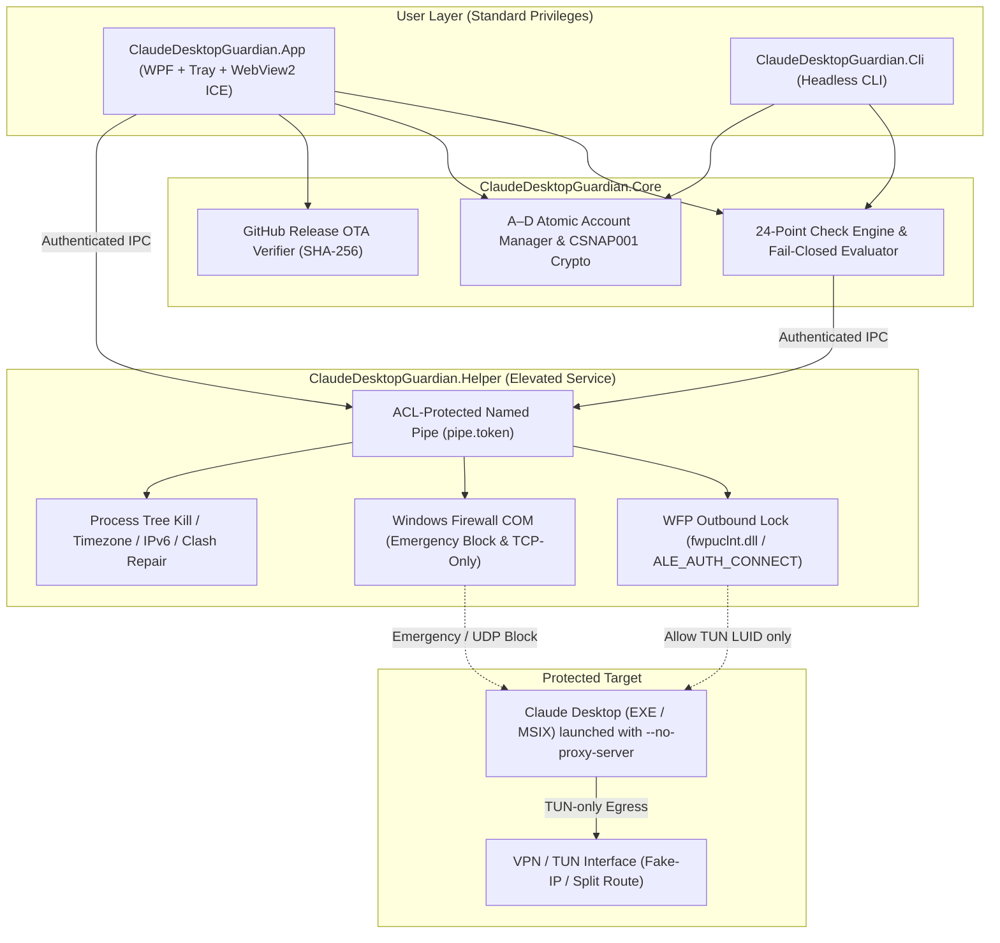

<div align="center">


<h1>claude-damn</h1>

<p><strong>Kernel-Level Network Guardian &amp; Multi-Account Isolation Workbench for Claude Desktop on Windows</strong></p>

<p>
  Native <code>.NET 8 / WPF</code> &middot; WFP <code>ALE_AUTH_CONNECT</code> Lock &middot; 24-Point Verification Matrix &middot; Atomic <code>A–D</code> Account Slots &middot; GitHub Release OTA
</p>

<p>
  <a href="https://github.com/zxl3305479573-max/claude-damn/releases"></a>
  <a href="https://github.com/zxl3305479573-max/claude-damn/actions/workflows/guardian-ci.yml"></a>
  
  
  <a href="https://github.com/zxl3305479573-max/claude-damn/stargazers"></a>
  <a href="https://github.com/zxl3305479573-max/claude-damn/releases"></a>
</p>

<p>
  <a href="./README.md">简体中文</a> &middot;
  <strong>English</strong> &middot;
  <a href="./README.ja.md">日本語</a>
</p>

<p>
  <a href="#key-capabilities">Capabilities</a> &middot;
  <a href="#architecture">Architecture</a> &middot;
  <a href="#24-point-check-matrix">24-Point Matrix</a> &middot;
  <a href="#quick-start">Quick Start</a> &middot;
  <a href="#tun-only-mode-alongside-system-proxy">TUN-Only Mode</a> &middot;
  <a href="#cli-reference">CLI</a> &middot;
  <a href="#build-test--ota-updates">Build &amp; OTA</a>
</p>

</div>

---

> [!NOTE]
> **claude-damn** is a native Windows desktop guardian and multi-account workbench built with `.NET 8` and `WPF`. It protects **Claude Desktop** (both classic EXE and MSIX builds) against real-IP, IPv6, DNS, route, and WebRTC leaks through kernel-level **Windows Filtering Platform (WFP)** rules, Fail-Closed firewall emergency kill-switches, a 24-point live inspection matrix, atomic `A–D` account isolation, and SHA-256 verified GitHub Release OTA updates.

## Key Capabilities

### 1. Kernel-Level Dual-Layer Defense & Fail-Closed Gate

| Mechanism | Description |
| :--- | :--- |
| **WFP Kernel Outbound Lock + Firewall Kill-Switch** | Optionally enables native WFP (`fwpuclnt.dll`) `ALE_AUTH_CONNECT` TUN-only outbound whitelisting (with optional loopback passthrough for local MCP/proxies). Enabling terminates existing current-user Claude Desktop processes and verifies exit so stale sockets cannot bypass `ALE_AUTH_CONNECT`. Paired with idempotent `HNetCfg.FwPolicy2` firewall blocking and ownership-verified process-tree termination on trip. |
| **Claude TCP-Only Mode *(Off by Default)*** | Blocks all outbound UDP across all ports, interfaces, and profiles for identified Claude EXE/MSIX binaries under the dedicated `ClaudeDesktopGuardian.<SID>.TcpOnly` group without touching proxy cores. Activation, startup recovery, and explicit repair verify old-session exit and read back rules. Once enabled, missing/stale rules or insufficient evidence block launch and cannot be downgraded by optional settings. Clean exit and uninstall remove only managed rules while preserving the toggle for next launch. *(May impact voice, video, or real-time features.)* |
| **Fail-Closed Lock & Safe Launch Gate** | Tripping a blocking fault enters a persistent locked state—neither Claude exiting nor 5-second light checks auto-unlock it, and any relaunched Claude process is forcibly terminated again. **Safe Launch Claude** (window & tray) launches EXE or MSIX only when unlocked and all hard checks pass. |
| **Dual-Path Consistency & Strict Path Gate** | When a Windows HTTP system proxy is active, probes both the proxy path and a proxy-bypassing TUN path in parallel, keeping dual evidence and blocking on country or egress mismatch. Immediately skips all external probes whenever the proxy client or VPN/TUN adapter goes offline so the real IP is never exposed directly. |
| **Multi-Client & Multi-Source Fallbacks** | Supports `auto`, `Clash Verge`, `FlClash`, `sing-box`, `ClashX`, `Surge`, `WireGuard`, and `other`, prioritizing `198.18.*` Fake-IP TUN adapters and `0.0.0.0/0` routes. IPv4 egress falls back through Cloudflare trace → `ipinfo.io` → `ipwho.is` → `api.ip.sb`; timezone resolves through `ipapi.co` → `ipinfo.io` → `ifconfig.co` → `ipwho.is` → ICU/country mapping. |
| **Dual Install Discovery & Single-Instance Protection** | Auto-discovers `%LOCALAPPDATA%\AnthropicClaude`, `%LOCALAPPDATA%\Programs\Claude`, and MSIX `WindowsApps\Claude_` + `Claude-Data\<PFN>`. Mutex (`Local\ClaudeDesktopGuardian.SingleInstance`) prevents duplicate instances; background async enumeration/probes keep WPF responsive with per-check timeouts and orderly tray-exit teardown. |

### 2. 24-Point Inspection Matrix & Region Auto-Adaptation

- **Hard Checks *(Never Skippable or Downgradable)***: Proxy client, VPN/TUN adapter, per-target Windows best route (`default-route`), egress IP, IPv6 active routing table (`::/0`, `2000::/3`, `64:ff9b::/96`) + forced IPv6 egress probe, elevated Helper service, firewall policy readiness, WFP strict mode, and TCP-only policy (when enabled).
- **Route Verification & Evidence Freshness**: Resolves exact Windows best routes for specific probe targets and active Claude connections to catch split default routes and more-specific physical bypasses; direct TUN HTTP probes verify the egress interface prior to connecting. Network context changes trigger full re-checks; same-adapter egress baselines refresh at most every **60 s**. Every `Evidence` payload records `observed_at`, `cached`, `collection_state`, and `collection_error`—collection failures or empty readouts never fake green.
- **Policy & Optional Checks *(True Single-Item Recheck, Per-Item `Skip`, Optional `Warn` Downgrade)***:
  - Claude process tree & active dual-stack connections (allows TCP `443` and loopback; flags non-443 remote ports)
  - Egress IP stability & 48-hour drift history (`iphistory.log`)
  - Real `claude.ai` DNS resolution & Fake-IP tunnel verification
  - Dual-layer WebRTC leak detection: native UDP STUN (`stun.cloudflare.com`, `stun.l.google.com`, `stun.miwifi.com`, `stun.chat.bilibili.com`) + embedded WebView2 browser ICE (`proxy` / `reject` policies; confirmed non-VPN public IP leaks are **never** downgraded)
  - Automatic exit timezone sync & restore on exit + system locale + Claude `config.json` language audit
  - **One-Click Region Re-Adaptation (`set-region`)**: Re-detects egress country, timezone, and expected locale after switching proxy nodes (rejects `CN` exits) and syncs the Windows timezone
  - Clash Verge / FlClash runtime mode & top-16 pinned kernel rules audit (13 Claude domains + 3 UDP-only STUN ports; FlClash auto-discovers local controller ports)
  - Egress ASN network classification (`ipinfo.io` + `PeeringDB`) & Claude HTTPS ecosystem reachability
  - 4 pluggable IP reputation checks (`ip-rep-score`, `ip-rep-proxy`, `ip-rep-hosting`, `ip-rep-blacklist`) via HTTPS-only custom endpoints (`{ip}` template or `?ip=`, `X-API-Key` header, local TTL cache)

### 3. Multi-Account Atomic Isolation & Encrypted Snapshots

- **Isolated `A–D` Account Slots**: Gated by Fail-Closed environment checks (refuses switching while locked or unhealthy). Uses process mutex (`Local\ClaudeDesktopGuardian.AccountOp`), `.new`/`.previous` staging swaps, residual recovery, and atomic pointer commits with automatic rollback. Account data lives independently under `%LOCALAPPDATA%\ClaudeDesktopGuardian\accounts`.
- **Cross-Account Shared Paths**: Supports a `keep-in-workspace.txt` whitelist that automatically rejects absolute paths, `..` traversal, and symlinks.
- **`.csnap` Encrypted Snapshot Portability**: Fully compatible with `claude-switcher`'s `CSNAP001` archive format (**PBKDF2-HMAC-SHA256** 200,000 iterations + **AES-256-CBC** + Encrypt-then-MAC **HMAC-SHA256** + per-entry Zip-Slip validation).

### 4. Maintenance Toolbox, CLI & Redacted Diagnostics

- **One-Click Environment Repair**: Executed via the elevated Helper—flushes DNS cache, syncs timezone, disables IPv6 bindings strictly on leaking non-VPN NICs, repairs Clash Verge `Script.js` by mode (auto-detects proxy groups, preserves custom `main`, restarts & verifies `/rules`, rolls back on failure), cleans legacy `Merge.yaml`, and refreshes WFP policy.
- **Read-Only Audits**: Device fingerprint audit (CJK fonts, GPU, resolution, virtualization markers), Claude Code CLI audit, and standalone proxy transport diagnostics (`diagnose-proxy`, zero client logs or state mutations, exit codes `0` / `1` / `2`).
- **Ephemeral Isolated Browser**: Launches with extensions disabled and `--force-webrtc-ip-handling-policy=disable_non_proxied_udp`, wiping its temporary profile directory immediately upon window close.
- **Redacted Logging & Diagnostic Bundle**: Persistent configuration in `%LOCALAPPDATA%\ClaudeDesktopGuardian\config.json`, 512 KiB rotating redacted logs (`logs\guardian.log`), and one-click `.zip` export stripped of IPs, API keys, and account secrets.

---

## Architecture



---

## 24-Point Check Matrix

<details>
<summary><strong>Click to expand the complete 24-point check matrix</strong></summary>

| # | Check ID | Check | Cadence | Enforcement | Pass Condition & Failure Behavior |
| :---: | :--- | :--- | :--- | :--- | :--- |
| 1 | `claude-process` | Claude Process Tree | 5 s | Info | Current-user Claude process detected (`Warn` if stopped; non-blocking) |
| 2 | `proxy-client` | Proxy Client | 5 s | **Hard** | Target or auto-detected proxy client/service online; failure blocks & skips external probes |
| 3 | `vpn-adapter` | VPN/TUN Adapter | 5 s | **Hard** | Virtual adapter `Up` with non-APIPA IPv4; failure blocks & skips external probes |
| 4 | `default-route` | Target Best Route | 5 s | **Hard** | Best route for probe targets & active Claude destinations uses TUN (split-route aware); bypass/read error blocks |
| 5 | `egress-ip` | Egress IP | ≤ 60 s / Context | **Hard** | Non-`CN`, matches target region, and agrees between system proxy and direct TUN paths |
| 6 | `ip-consistency` | IP Stability | 30 min / Manual | Optional | Matches previous IP with &lt; 3 distinct exits in 48 h (`Warn`) |
| 7 | `timezone` | Timezone Sync | Startup / 30 min | Optional | Windows timezone matches exit IANA mapping; auto-synced & restored on exit/uninstall |
| 8 | `locale` | System Locale | 30 min / Manual | Optional | `CurrentCulture.Name` matches expected region (`Warn`) |
| 9 | `dns` | DNS Resolution | 30 min / Context | Optional | Valid resolution collected; Fake-IP TUN matches `198.18.*` (`Unknown` on empty/error) |
| 10 | `ipv6` | IPv6 Egress | 30 min / Manual | **Hard** | No `::/0`, `2000::/3`, or `64:ff9b::/96` on non-VPN NICs; public IPv6 matches IPv4 country |
| 11 | `webrtc` | WebRTC Leak | Startup / 30 min | Toggleable *(Leak = Hard)* | Native STUN + WebView2 ICE show no non-VPN public IP; confirmed leaks **never** downgrade |
| 12 | `active-connections` | Active Connections | 5 s | Policy | Dual-stack TCP/UDP read succeeds; established TCP uses `443` or loopback only |
| 13 | `helper-service` | Elevated Helper | 5 s | **Hard** | ACL-restricted named pipe responds with valid status |
| 14 | `wfp-policy` | WFP Outbound Lock | 5 s | **Hard** *(Strict)* | `active` when WFP strict mode is enabled (`off`/`stale`/`unavailable` blocks) |
| 15 | `firewall-readiness` | Firewall Readiness | 5 s | **Hard** | `BFE`/`MpsSvc` healthy, active profile enabled, local policy effective, rules readable |
| 16 | `clash-rules` | Clash Pinned Rules | 30 min / Manual | Optional | Top-16 kernel rules match 13 Claude domains + 3 UDP STUN rules in Rule mode |
| 17 | `client-language` | Client Language | 30 min / Manual | Optional | Claude `config.json` `locale` prefix matches target (`Warn`) |
| 18 | `asn` | ASN Network Type | 30 min / Manual | Optional | `ipinfo.io` + `PeeringDB` classify exit as `Cable/DSL/ISP` (`Warn` otherwise) |
| 19 | `claude-domains` | Claude HTTPS | 30 min / Context | Optional | Valid HTTP numeric response (`2xx`/`3xx` normal; expected API `401` auth-required; `403`/`429` `Warn`) |
| 20 | `ip-rep-score` | IP Risk Score | 30 min / Manual | Optional *(Pluggable)* | Custom HTTPS reputation score below threshold |
| 21 | `ip-rep-proxy` | IP Proxy Flags | 30 min / Manual | Optional *(Pluggable)* | Public proxy, VPN, and Tor flags all false |
| 22 | `ip-rep-hosting` | IP Hosting Flag | 30 min / Manual | Optional *(Pluggable)* | Non-datacenter/hosting IP |
| 23 | `ip-rep-blacklist` | IP Blacklist | 30 min / Manual | Optional *(Pluggable)* | Blacklist hit count is `0` |
| 24 | `tcp-only-policy` | Claude TCP-Only | 5 s | **Hard** *(When On)* | Dedicated UDP-block rule group verified for current-user Claude EXE/MSIX (`Skip` when off) |

</details>

<details>
<summary><strong>Evidence Semantics, WebRTC DNS Pre-Resolution &amp; Verification Boundaries</strong></summary>

- **HTTP & Evidence Boundaries**: HTTP `2xx`/`3xx` indicates normal reachability; expected API `401` indicates transport reached the server and requires auth; `403`/`429`/other server errors show `Warn`; exceptions or missing responses show `Unknown`. None of these prove account standing or messaging availability. DNS verifies resolution/Fake-IP traits only; bound UDP endpoints do not prove transmitted traffic; Guardian's WebRTC probe is independent of Claude's internal stack; firewall rule read-back does not substitute for packet capture; unconfigured, incomplete, or stale IP reputation sources never imply a clean IP.
- **TCP-Only Controls**: Enable via Settings (**Claude TCP-only**) or CLI (`set-check-config '{"tcpOnlyEnabled":true}'` / `tcp-only-enable`), query via `tcp-only-status`, or disable and clean up managed rules via `tcp-only-disable` (requires an online up-to-date Helper). TCP-only constrains UDP only—keep **WFP Strict Mode** enabled to restrict TCP exclusively to the TUN interface.
- **WebRTC `701` Handling & Pre-Resolution**: Prior to browser ICE probing, plain `stun:` hostnames are pre-resolved via system DNS into their IPv4/IPv6 addresses (preserving ports and transport parameters) to avoid spurious missing-family lookup errors; `stuns:` and TURN URLs remain untouched, and DNS failures preserve the original URL so real errors are still reported. If ICE gathering completes with public candidates matching the HTTP egress baseline, every native STUN probe succeeds matching the egress IP, and only `701 / STUN host lookup received error` remains for STUN hosts already verified by the native probe, WebRTC reports a non-blocking warning while preserving raw error and candidate evidence. Any unexpected public IP always fails and cannot be ignored or downgraded.

</details>

---

## Quick Start

### Prerequisites

- **OS**: Windows 10 / 11 (x64)
- **Runtime**: [Microsoft Edge WebView2 Runtime](https://developer.microsoft.com/en-us/microsoft-edge/webview2/) (for embedded WebRTC ICE probing)
- **Permissions**: Administrator PowerShell for installation, uninstallation, and the elevated Helper service
- **From Source**: [.NET 8 SDK](https://dotnet.microsoft.com/download/dotnet/8.0) (optional: Node.js for `leak-check.js` syntax check)

### Option 1: Prebuilt Release *(Recommended)*

1. Download `ClaudeDesktopGuardian-<version>-windows-x64.zip` and `SHA256SUMS-release.txt` from [GitHub Releases](https://github.com/zxl3305479573-max/claude-damn/releases).
2. Verify the archive checksum in PowerShell:
   ```powershell
   Get-FileHash .\ClaudeDesktopGuardian-*-windows-x64.zip -Algorithm SHA256
   ```
3. Extract to your preferred directory and launch `ClaudeDesktopGuardian.App.exe` (or run `install.ps1` from source to register auto-start scheduled tasks).

### Option 2: Build & Install from Source

Run in an **Administrator PowerShell**:

```powershell
# Build & install to default directory (D:\Apps\claude-damn)
.\install.ps1

# Or specify a custom installation path
.\install.ps1 -InstallDir D:\Apps\claude-damn

# Clean uninstall (invokes Helper --cleanup-all to remove WFP/firewall rules & restore timezone; preserves user accounts)
.\install.ps1 -Uninstall
.\install.ps1 -Uninstall -InstallDir D:\Apps\claude-damn
```

> [!TIP]
> Clicking the window close button (`×`) minimizes **claude-damn** to the system tray. To cleanly restore your original Windows timezone, remove managed firewall rules, and tear down the WFP outbound lock, select **"Exit & Restore Timezone and Network Policy"** from the tray menu.

---

## TUN-Only Mode Alongside System Proxy

**claude-damn** lets Claude Desktop route exclusively through your VPN/TUN interface while other tools (such as Codex or browsers) continue using the Windows system proxy untouched:

- **Safe Launch & Post-Switch Auto-Launch** pass Electron's `--no-proxy-server` flag (via CLI arguments for classic EXE, and Windows app activation parameters for MSIX). Classic EXE child processes also strip inherited `HTTP_PROXY` / `HTTPS_PROXY` / `ALL_PROXY` environment variables without altering system proxy settings.
- **Strict Kernel Enforcement**: Enable **WFP Strict Mode** and keep **"Allow Local Loopback"** turned **OFF**. `--no-proxy-server` bypasses the system proxy while WFP blocks any non-TUN traffic—both layers complement each other and are not interchangeable.

> [!IMPORTANT]
> Fully close any running Claude Desktop instance before launching via Guardian (existing instances are rejected so Electron single-instance forwarding cannot drop `--no-proxy-server`). Launching Claude directly from a desktop shortcut or Windows startup will not attach `--no-proxy-server`, and strict WFP will continue blocking loopback proxy connections. Downstream proxy node selection behind TUN remains governed by your Clash/TUN rules.

---

## CLI Reference

`ClaudeDesktopGuardian.Cli.exe` shares `ClaudeDesktopGuardian.Core` for scripting, automation, and headless verification:

| Command | Description |
| :--- | :--- |
| `check` / `checkdetail` | Run the full 24-point check (`OK`/`FAIL` summary or line-by-line detail) |
| `check-item <check-id>` | True single-item recheck with minimal dependency refresh |
| `status` / `switch <A\|B\|C\|D> [--no-launch]` | Show active slot or perform Fail-Closed atomic account switch |
| `set-region` | Re-detect exit country/timezone/locale after switching proxy nodes |
| `get-client` / `set-client <mode>` | View or set proxy client mode (`auto`, `clash-verge`, `flclash`, `sing-box`, `clashx`, `surge`, `wireguard`, `other`) |
| `get-flclash-controller` / `set-flclash-controller <port\|127.0.0.1:port\|auto>` | Configure FlClash local controller discovery |
| `tcp-only-enable` / `tcp-only-status` / `tcp-only-disable` | Manage and inspect dedicated Claude outbound UDP block rules |
| `rules-status` / `fingerprint` / `cli-info` | Inspect Clash pinned rules, device fingerprint, and Claude Code CLI environment |
| `open-safe <http(s)://url>` | Open a URL in an ephemeral WebRTC-hardened browser profile |
| `diagnose-proxy [--proxy <url> \| --config <file.json>]` | Zero-side-effect standalone proxy transport test (exit codes `0`/`1`/`2`) |
| `snapshot-export <A\|B\|C\|D> <file.csnap>` | Export encrypted `CSNAP001` snapshot *(password via stdin)* |
| `snapshot-import <file.csnap> <A\|B\|C\|D>` | Import encrypted `CSNAP001` snapshot *(password via stdin)* |
| `get-check-config` / `set-check-config '<json>'` | Read or patch check configuration (`tcpOnlyEnabled`, `disabled`, `webrtcPolicy`, `ipReputation`, etc.) |
| `export-diagnostics <file.zip>` | Export redacted diagnostic archive stripped of IPs and secrets |

---

## Build, Test & OTA Updates

### Local Build & Regression Suite

```powershell
# Run core & WPF/Dispatcher/named-pipe regression tests
dotnet run --project tests\ClaudeDesktopGuardian.Tests.csproj -c Release

# Build individual projects
dotnet build src\ClaudeDesktopGuardian.Core\ClaudeDesktopGuardian.Core.csproj -c Release
dotnet build src\ClaudeDesktopGuardian.Helper\ClaudeDesktopGuardian.Helper.csproj -c Release
dotnet build src\ClaudeDesktopGuardian.App\ClaudeDesktopGuardian.App.csproj -c Release
dotnet build src\ClaudeDesktopGuardian.Cli\ClaudeDesktopGuardian.Cli.csproj -c Release

# Verify embedded WebRTC script syntax
node --check src\ClaudeDesktopGuardian.App\web\webrtc\leak-check.js
```

Run the full release pipeline (builds, regression tests, JS syntax check, PowerShell UTF-8 BOM/AST validation, and shared-runtime publish to `publish\win-x64` at ~164 MB):

```powershell
.\build.ps1
```

For local development, launch the elevated Helper before starting the WPF app:

```powershell
dotnet run --project src\ClaudeDesktopGuardian.Helper\ClaudeDesktopGuardian.Helper.csproj
dotnet run --project src\ClaudeDesktopGuardian.App\ClaudeDesktopGuardian.App.csproj
```

*Regression tests include STA / WPF Dispatcher responsiveness checks (ensuring full, light, and single-item checks never freeze UI input and WebView2 stays on the UI thread) as well as isolated random-pipe Clash TUN diagnostic tests that touch no real proxy or system settings.*

### GitHub Release OTA Updates

- Guardian performs a read-only check against GitHub Releases on startup (or manually via **Check for Updates**).
- Before installing, it downloads the shared-runtime package, verifies its **SHA-256** checksum against `SHA256SUMS-release.txt`, requests UAC elevation, restores timezone and network policies, and atomically swaps binaries.
- Failed updates roll back automatically; previous binaries are preserved under `.rollback.<tx>`. User account slots, configuration, and runtime state in `%LOCALAPPDATA%\ClaudeDesktopGuardian` are untouched by OTA updates.
- Pushing a `guardian-vMAJOR.MINOR.PATCH` tag triggers [`.github/workflows/guardian-release.yml`](./.github/workflows/guardian-release.yml) to build and publish the Windows x64 zip and SHA-256 manifest.

> [!WARNING]
> If upgrading from an older version stuck during a check, the single-instance mutex will focus the hung process instead of launching the new binary. Terminate the old instance first before launching the updated build.

---

## Project Structure

```text
claude-damn/
├── src/
│   ├── ClaudeDesktopGuardian.App/      # WPF UI, tray integration, WebView2 ICE probe & app icon
│   ├── ClaudeDesktopGuardian.Core/     # 24-point check engine, WFP/route/probe logic, A–D slots, CSNAP001, OTA
│   ├── ClaudeDesktopGuardian.Helper/   # Elevated named-pipe service (WFP, Firewall COM, TCP-only, repairs)
│   └── ClaudeDesktopGuardian.Cli/      # Headless CLI reusing Core
├── tests/                              # Regression suite (STA/Dispatcher, synthetic network/firewall/pipe tests)
├── docs/                               # Technical evaluation & acceptance documentation
├── .github/workflows/                  # CI (guardian-ci.yml) & tag-driven Release (guardian-release.yml)
├── build.ps1                           # Full validation & shared-runtime publish script
├── install.ps1                         # Elevated installer / clean uninstaller
├── apply-update.ps1                    # Verified OTA swap & rollback script (UTF-8 BOM)
└── THIRD_PARTY_NOTICES.md              # Third-party component attributions
```

---

## Documentation & Acknowledgments

- **Full Feature Inventory & Quick-Start Guide (Chinese)**: [`docs/使用指南.md`](./docs/使用指南.md)
- **Evaluation & Architecture Specification**: [`docs/评测文档.md`](./docs/评测文档.md)
- **Third-Party Notices**: [`THIRD_PARTY_NOTICES.md`](./THIRD_PARTY_NOTICES.md) — Browser-side WebRTC candidate collection uses [`@myipscan/leak-check`](https://github.com/MyIPScan/leak-check) (`1.0.4`, MIT).
- **Snapshot Format Compatibility**: `.csnap` (`CSNAP001`) encrypted archives maintain format compatibility with [`claude-switcher`](https://github.com/YOURSJEYO/claude-switcher).
