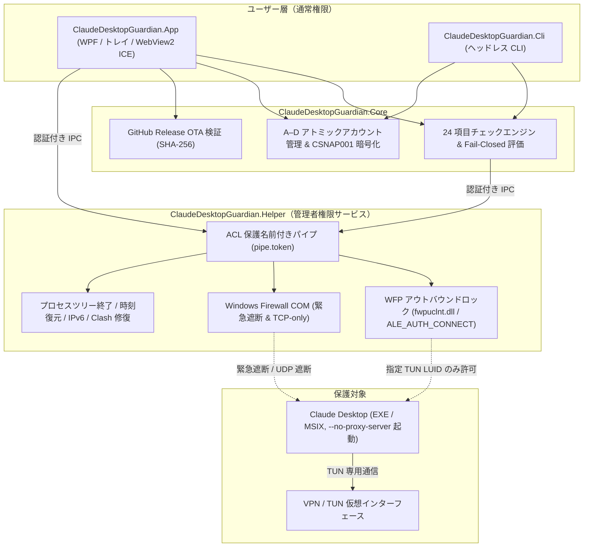

<div align="center">


<h1>claude-damn</h1>

<p><strong>Windows 向け Claude Desktop カーネル級ネットワークガード &amp; マルチアカウント隔離ワークベンチ</strong></p>

<p>
  ネイティブ <code>.NET 8 / WPF</code> &middot; WFP <code>ALE_AUTH_CONNECT</code> ロック &middot; 24 項目リアルタイム診断 &middot; <code>A–D</code> アトミックアカウント隔離 &middot; GitHub Release OTA
</p>

<p>
  <a href="https://github.com/snowpear-lab/claude-damn/releases"></a>
  <a href="https://github.com/snowpear-lab/claude-damn/actions/workflows/guardian-ci.yml"></a>
  
  
  <a href="https://github.com/snowpear-lab/claude-damn/stargazers"></a>
  <a href="https://github.com/snowpear-lab/claude-damn/releases"></a>
</p>

<p>
  <a href="./README.md">简体中文</a> &middot;
  <a href="./README.en.md">English</a> &middot;
  <strong>日本語</strong>
</p>

<p>
  <a href="#主な機能">主な機能</a> &middot;
  <a href="#アーキテクチャ">アーキテクチャ</a> &middot;
  <a href="#24-項目チェックマトリクス">24 項目マトリクス</a> &middot;
  <a href="#クイックスタート">クイックスタート</a> &middot;
  <a href="#システムプロキシ併用-tun-専用モード">TUN 専用モード</a> &middot;
  <a href="#cli-リファレンス">CLI</a> &middot;
  <a href="#ビルドテストと-ota-アップデート">ビルド・OTA</a>
</p>

</div>

---

> [!NOTE]
> **claude-damn** は `.NET 8 / WPF` で実装された Windows 向け Claude Desktop ネットワーク保護およびマルチアカウント隔離ワークベンチです。ネイティブ **Windows Filtering Platform (WFP)** アウトバウンド制御、Fail-Closed 緊急遮断、24 項目の環境診断マトリクス、`A–D` アトミックアカウント切替、SHA-256 検証付き GitHub Release OTA により、Claude Desktop（通常 EXE / MSIX 両対応）の実 IP・IPv6・DNS・ルート・WebRTC リークを徹底防御します。

## 主な機能

### 1. カーネル級 2 層防御と Fail-Closed ゲート

| 防御レイヤー | 概要 |
| :--- | :--- |
| **WFP カーネルロック + ファイアウォール緊急停止** | ネイティブ WFP (`fwpuclnt.dll`) の `ALE_AUTH_CONNECT` により TUN インターフェース専用アウトバウンド許可を設定可能（ローカル MCP/プロキシ向けループバック許可は選択式）。有効化時に現行ユーザーの既存 Claude プロセスを終了・確認し、既存接続のバイパスを防止。**TUN 再接続時の WFP 自動再バインド**およびジャンクション重複による `stale` 誤検知修正、高並列ヘルパー名前付きパイプに対応。異常検知時は冪等な `HNetCfg.FwPolicy2` 遮断とプロセスツリー強制終了を連動実行します。 |
| **Claude TCP-only *(独立設定・初期値オフ)*** | 専用グループ `ClaudeDesktopGuardian.<SID>.TcpOnly` で検出済み Claude EXE/MSIX の全アウトバウンド UDP（全ポート・全インターフェース・全プロファイル）を遮断（プロキシコアは対象外）。有効化・起動復元・修復時に既存セッション終了とルール再読込を検証。有効時にルール欠損・失効・証拠不足があれば起動を阻止し、任意チェックによる格下げ不可。正常終了・アンインストール時は管理ルールのみ清掃し設定を保持します。*（音声・映像等のリアルタイム機能に影響する場合があります。）* |
| **Fail-Closed ロックと安全起動ゲート** | 遮断レベル異常を検知するとロック状態を永続化。Claude 終了や 5 秒軽量巡回では自動解除されず、ロック中に再起動された Claude も再終了します。「安全起動」ボタン／トレイメニューからは未ロックかつ全必須チェック合格時のみ起動を許可します。 |
| **システムプロキシ / TUN 二重経路検証 & 厳格ゲート** | Windows HTTP プロキシ有効時は、プロキシ経由とプロキシ回避 TUN 直結の双方を並列計測し、国または出口 IP の乖離で遮断。プロキシクライアントや VPN/TUN アダプタがオフラインの場合は即座に外部プローブをスキップし、実 IP の直接露出を防ぎます。 |
| **マルチクライアント対応 & 多段フォールバック** | `auto` / `Clash Verge` / `FlClash` / `sing-box` / `ClashX` / `Surge` / `WireGuard` / `other` に対応し、`198.18.*` Fake-IP TUN と `0.0.0.0/0` ルートを優先認識。IPv4 出口は Cloudflare trace → `ipinfo.io` → `ipwho.is` → `api.ip.sb`、タイムゾーンは `ipapi.co` → `ipinfo.io` → `ifconfig.co` → `ipwho.is` → ICU マッピングで多段解決します。 |
| **EXE / MSIX 両対応 & 単一インスタンス保護** | `%LOCALAPPDATA%\AnthropicClaude`、`%LOCALAPPDATA%\Programs\Claude`、MSIX `WindowsApps\Claude_` および `Claude-Data\<PFN>` を自動検出。ミューテックス (`Local\ClaudeDesktopGuardian.SingleInstance`) で多重起動を防ぎ、非同期バックグラウンド巡回・タイムアウト保護・トレイ安全終了を備えます。 |

### 2. 24 項目環境診断マトリクスと地域自動適応

- **必須ハードチェック *(スキップ・格下げ不可)***：プロキシクライアント、VPN/TUN アダプタ、宛先別最適ルート (`default-route`)、出口 IP、IPv6 ルーティングテーブル (`::/0`・`2000::/3`・`64:ff9b::/96`) + 強制 IPv6 出口プローブ、管理者ヘルパー、ファイアウォール有効性、WFP 厳格モード、有効時の TCP-only ポリシー。
- **最適ルート検証と証跡鮮度**：具体的な宛先ごとに Windows 最適ルートを取得し、分割デフォルトルートやより具体的な物理バイパスを検出（ループバック・プライベート・リンクローカル接続を除外しつつ `198.18.*` とパブリック宛先を検査し、ULA IPv6 のみの TUN による誤遮断を防止）。直結 TUN プローブは接続前にインターフェースを検証します。ネットワーク変化時はフル再検証し、同一アダプタの出口基準は最大 **60 秒** で更新。全 `Evidence` に `observed_at`・`cached`・`collection_state`・`collection_error` を記録し、取得失敗を正常扱いしません。
- **ポリシー・任意チェック *(単項目再検証・項目別 `Skip`・`Warn` 格下げ対応)***：
  - Claude プロセスツリーとアクティブ接続監査（TCP `443` とループバックのみ許可）
  - 出口 IP 安定性と 48 時間ドリフト履歴 (`iphistory.log`)
  - `claude.ai` DNS 解決および Fake-IP トンネル検証
  - ネイティブ UDP STUN + 内蔵 WebView2 ICE による 2 層 WebRTC リーク検査（`proxy` / `reject` ポリシー対応、確定した非 VPN グローバル IP リークは**格下げ不可**）
  - 出口タイムゾーン自動同期・終了時復元 + システム Locale + Claude `config.json` 言語検証
  - **ワンクリック地域再適応 (`set-region`)**：ノード切替後に出口国・タイムゾーン・Locale を再取得（`CN` 出口は拒否）しシステム時刻を同期
  - Clash Verge / FlClash 動作モードおよびカーネル先頭 16 件の固定ルール監査（13 Claude ドメイン + 3 UDP 専用 STUN ポート、FlClash ローカルポート自動検出）
  - ASN ネットワーク種別監査 (`ipinfo.io` + `PeeringDB`) と Claude HTTPS 到達性検査
  - プラグイン式 4 項目 IP レピュテーション検査（スコア・プロキシ判定・データセンター判定・ブラックリスト、HTTPS 専用 + `X-API-Key` + ローカル TTL キャッシュ）

### 3. マルチアカウントのトランザクション隔離と暗号化スナップショット

- **`A–D` 独立アカウントスロット**：Fail-Closed 環境ゲート下でのみ切替を許可。プロセス間ミューテックス (`Local\ClaudeDesktopGuardian.AccountOp`)、`.new`/`.previous` ステージング入替、残存復旧、アトミックポインタ確定と自動ロールバックを採用。データは `%LOCALAPPDATA%\ClaudeDesktopGuardian\accounts` に独立保存されます。
- **アカウント間共有ホワイトリスト**：`keep-in-workspace.txt` に対応（絶対パス、`..` 越境、シンボリックリンクを自動拒否）。
- **`.csnap` 暗号化スナップショット**：`claude-switcher` の `CSNAP001` 形式と完全互換（**PBKDF2-HMAC-SHA256** 200,000 回 + **AES-256-CBC** + Encrypt-then-MAC **HMAC-SHA256** + Zip-Slip 検証付き展開）。

### 4. メンテナンスツール・CLI・マスク済み診断

- **ワンクリック環境修復**：管理者ヘルパー経由で DNS キャッシュクリア、タイムゾーン同期、リークしている非 VPN NIC のみ IPv6 無効化、Clash Verge `Script.js` のモード別修復（プロキシグループ自動検出・既存 `main` 保持・再起動後 `/rules` 検証・失敗時自動ロールバック）、旧 `Merge.yaml` 削除、WFP ポリシー再適用を実行。
- **読み取り専用診断ツール**：デバイスフィンガープリント検査、Claude Code CLI 環境検査、独立プロキシ通信診断 (`diagnose-proxy`、ログ・状態ファイル無生成、終了コード `0`/`1`/`2`)。
- **使い捨て隔離ブラウザ**：拡張機能と非プロキシ UDP (`--force-webrtc-ip-handling-policy=disable_non_proxied_udp`) を強制無効化し、終了時に一時プロファイルを自動破棄。
- **永続設定とマスク済み診断パッケージ**：`%LOCALAPPDATA%\ClaudeDesktopGuardian\config.json`、512 KiB 自動ローテーションのマスク済みログ (`logs\guardian.log`)、IP・API キーを除去した診断 `.zip` エクスポート。

---

## アーキテクチャ



---

## 24 項目チェックマトリクス

<details>
<summary><strong>クリックして全 24 項目マトリクスを展開</strong></summary>

| # | Check ID | 項目名 | 周期 | 種別 | 合格条件・異常時挙動 |
| :---: | :--- | :--- | :--- | :--- | :--- |
| 1 | `claude-process` | Claude プロセスツリー | 5 秒 | 情報 | 現行ユーザーの Claude プロセスを検出（未起動時は `Warn`） |
| 2 | `proxy-client` | プロキシクライアント | 5 秒 | **必須** | 対象または自動検出クライアント稼働中；失敗時は遮断し外部プローブをスキップ |
| 3 | `vpn-adapter` | VPN/TUN アダプタ | 5 秒 | **必須** | 仮想 NIC が `Up` かつ非 APIPA IPv4 を保持；失敗時は外部プローブをスキップ |
| 4 | `default-route` | 宛先別最適ルート | 5 秒 | **必須** | プローブ宛先およびアクティブ接続の最適ルートが TUN 経由（分割ルート対応） |
| 5 | `egress-ip` | 出口 IP | ≤ 60 秒 / 変化 | **必須** | 非 `CN`・期待国一致、システムプロキシ経路と TUN 直結経路の出口が一致 |
| 6 | `ip-consistency` | IP 安定性 | 30 分 / 手動 | 任意 | 前回 IP と一致かつ 48 時間内の異なる出口が 3 未満 (`Warn`) |
| 7 | `timezone` | タイムゾーン整合 | 起動 / 30 分 | 任意 | Windows タイムゾーンが出口 IANA に対応（終了・アンインストール時に復元） |
| 8 | `locale` | システム Locale | 30 分 / 手動 | 任意 | `CurrentCulture.Name` が目標地域と一致 (`Warn`) |
| 9 | `dns` | DNS 解決 | 30 分 / 変化 | 任意 | 有効な解決結果を取得し、Fake-IP TUN は `198.18.*` と一致 |
| 10 | `ipv6` | IPv6 出口 | 30 分 / 手動 | **必須** | 非 VPN NIC に `::/0`・`2000::/3`・`64:ff9b::/96` が無く、公開 IPv6 は IPv4 と同国 |
| 11 | `webrtc` | WebRTC リーク | 起動 / 30 分 | 切替可 *(リーク必須)* | ネイティブ STUN と WebView2 ICE に非 VPN グローバル候補無し；確定リークは**格下げ不可** |
| 12 | `active-connections` | アクティブ接続 | 5 秒 | ポリシー | デュアルスタック TCP/UDP 取得成功、確立済み TCP は `443` またはループバックのみ |
| 13 | `helper-service` | 管理者ヘルパー | 5 秒 | **必須** | ACL 制限付き名前付きパイプが正常応答 |
| 14 | `wfp-policy` | WFP カーネルロック | 5 秒 | **必須** *(厳格時)* | 厳格モード有効時に `active`（`off`/`stale`/`unavailable` は遮断） |
| 15 | `firewall-readiness` | ファイアウォール状態 | 5 秒 | **必須** | `BFE`/`MpsSvc` 正常、アクティブプロファイル有効、ローカルポリシー有効・読取可能 |
| 16 | `clash-rules` | Clash 固定ルール | 30 分 / 手動 | 任意 | Rule モード時に先頭 16 ルール（13 ドメイン + 3 UDP STUN）とポリシーが整合 |
| 17 | `client-language` | クライアント言語 | 30 分 / 手動 | 任意 | Claude `config.json` の `locale` プレフィックスが目標と一致 (`Warn`) |
| 18 | `asn` | ASN 種別 | 30 分 / 手動 | 任意 | `ipinfo.io` + `PeeringDB` が `Cable/DSL/ISP` と判定（その他は `Warn`） |
| 19 | `claude-domains` | Claude HTTPS | 30 分 / 変化 | 任意 | 有効な数値応答（`2xx`/`3xx` 正常、API `401` 認証要、`403`/`429` は `Warn`） |
| 20 | `ip-rep-score` | IP リスクスコア | 30 分 / 手動 | 任意 *(外部)* | HTTPS レピュテーション API のスコアが閾値未満 |
| 21 | `ip-rep-proxy` | IP プロキシ判定 | 30 分 / 手動 | 任意 *(外部)* | 公開プロキシ / VPN / Tor のすべてが偽 |
| 22 | `ip-rep-hosting` | IP データセンター判定 | 30 分 / 手動 | 任意 *(外部)* | ホスティング／データセンター IP でないこと |
| 23 | `ip-rep-blacklist` | IP ブラックリスト | 30 分 / 手動 | 任意 *(外部)* | ブラックリスト一致件数が `0` |
| 24 | `tcp-only-policy` | Claude TCP-only | 5 秒 | **必須** *(有効時)* | 専用グループの全アウトバウンド UDP 遮断を検証（無効時は `Skip`） |

</details>

<details>
<summary><strong>証跡の解釈境界・WebRTC DNS 事前解決・TCP-only 操作仕様</strong></summary>

- **証跡の限界**：HTTP `2xx`/`3xx` は到達性、期待される API `401` は認証要求を示し、`403`/`429` は警告、例外や無応答は未検証となります。いずれもアカウント有効性やメッセージ送信可否を保証しません。DNS は解決・Fake-IP 特徴のみ検証し、UDP バインドは送信完了を意味せず、Guardian の WebRTC プローブやルール読込はパケットキャプチャや Claude 内部挙動の代替ではありません。レピュテーション未設定・欠損・期限切れはクリーン IP を意味しません。
- **TCP-only 操作**：設定画面または CLI（`set-check-config '{"tcpOnlyEnabled":true}'` / `tcp-only-enable`）で有効化、`tcp-only-status` で参照、`tcp-only-disable` で無効化および管理ルール削除（最新版の稼働中ヘルパーが必要）。TCP-only は UDP のみ制御するため、TCP を TUN 限定にするには **WFP 厳格モード** を併用してください。
- **WebRTC `701` 警告と事前解決**：ブラウザ ICE 計測前に通常の `stun:` ホスト名をシステム DNS で IPv4/IPv6 アドレスへ事前解決し、欠損アドレス族による重複解決エラーを防止します（`stuns:` と TURN URL はそのまま保持、DNS 失敗時も元 URL を残してエラーを報告）。ICE 収集完了・出口一致のグローバル候補あり・全ネイティブ STUN 成功かつ出口一致の状態で、ネイティブ検証済み STUN の `701 / STUN host lookup received error` のみが残る場合は非遮断警告として生証跡を保持します。想定外のグローバル IP が見つかった場合は常に `Fail` となり無視・格下げできません。

</details>

---

## クイックスタート

### 動作要件

- **OS**：Windows 10 / 11 (x64)
- **ランタイム**：[Microsoft Edge WebView2 Runtime](https://developer.microsoft.com/en-us/microsoft-edge/webview2/)（内蔵 WebRTC ICE プローブ用）
- **権限**：インストール・アンインストールおよび管理者ヘルパーに管理者権限が必要
- **ソースビルド時**：[.NET 8 SDK](https://dotnet.microsoft.com/download/dotnet/8.0)（任意：JS 構文検証用 Node.js）

### 方法 1：ビルド済み Release を使用 *（推奨）*

1. [GitHub Releases](https://github.com/snowpear-lab/claude-damn/releases) から `ClaudeDesktopGuardian-<version>-windows-x64.zip` と `SHA256SUMS-release.txt` を取得します。
2. PowerShell で SHA-256 を検証します：
   ```powershell
   Get-FileHash .\ClaudeDesktopGuardian-*-windows-x64.zip -Algorithm SHA256
   ```
3. 展開して `ClaudeDesktopGuardian.App.exe` を起動します（ログオン時自動起動タスクを登録する場合は `install.ps1` をご利用ください）。

### 方法 2：ソースからビルド・インストール

**管理者 PowerShell** で実行します：

```powershell
# デフォルト先 (D:\Apps\claude-damn) へビルド＆インストール
.\install.ps1

# インストール先を指定する場合
.\install.ps1 -InstallDir D:\Apps\claude-damn

# クリーンアンインストール（Helper --cleanup-all で WFP・FW ルール削除と時刻復元を実施、アカウントデータは保持）
.\install.ps1 -Uninstall
.\install.ps1 -Uninstall -InstallDir D:\Apps\claude-damn
```

> [!TIP]
> ウィンドウ右上の閉じるボタンはシステムトレイへの格納となります。元の Windows タイムゾーン復元、ファイアウォールルール清掃、WFP ロック解除を確実に行うには、トレイメニューの **「終了してタイムゾーンとネットワークポリシーを復元」** を選択してください。

---

## システムプロキシ併用 TUN 専用モード

Guardian の「安全起動」およびアカウント切替後の自動起動では Electron の `--no-proxy-server` を付与し、Codex など他アプリにシステムプロキシを残したまま Claude Desktop のみ TUN 経由に限定できます。

- **EXE / MSIX 両対応**：通常 EXE には起動引数と継承プロキシ環境変数（`HTTP_PROXY` / `HTTPS_PROXY` / `ALL_PROXY`）の除去を適用し、MSIX には Windows アプリケーションアクティベーション引数で渡します。システムプロキシ自体は変更しません。
- **WFP 厳格モードとの連携**：仮想 NIC への厳密な限定には **WFP 厳格モード有効** かつ **「ローカルループバック許可」オフ** を推奨します。起動引数がプロキシ回避を、WFP が非 TUN 通信の遮断を担います。

> [!IMPORTANT]
> 起動前に既存の Claude Desktop を完全に終了してください（既存インスタンスがあると単一インスタンス転送により `--no-proxy-server` が適用されないため起動を拒否します）。ショートカットや自動起動から直接起動すると引数が付かず、厳格 WFP によりローカルプロキシへの接続は遮断されます。TUN 先のノード選択は Clash 等のルールに従います。

---

## CLI リファレンス

`ClaudeDesktopGuardian.Cli.exe` はコアライブラリを共有し、スクリプト自動化やヘッドレス診断に利用できます：

| コマンド | 説明 |
| :--- | :--- |
| `check` / `checkdetail` | 全 24 項目チェックを実行（要約または詳細出力） |
| `check-item <check-id>` | 最小依存のみ更新する単項目再検証 |
| `status` / `switch <A\|B\|C\|D> [--no-launch]` | 現在スロット表示・Fail-Closed アトミック切替 |
| `set-region` | ノード切替後に出口国・タイムゾーン・Locale を再適応 |
| `get-client` / `set-client <mode>` | プロキシクライアント種別の確認・変更（`auto` / `clash-verge` / `flclash` / `sing-box` / `clashx` / `surge` / `wireguard` / `other`） |
| `get-flclash-controller` / `set-flclash-controller <port\|127.0.0.1:port\|auto>` | FlClash ローカルコントローラ設定 |
| `tcp-only-enable` / `tcp-only-status` / `tcp-only-disable` | Claude 専用アウトバウンド UDP 遮断の有効化・確認・無効化 |
| `rules-status` / `fingerprint` / `cli-info` | Clash 固定ルール・端末指紋・Claude Code CLI の読み取り専用診断 |
| `open-safe <http(s)://url>` | 拡張機能・非プロキシ UDP を無効化した一時隔離ブラウザを起動 |
| `diagnose-proxy [--proxy <url> \| --config <file.json>]` | 副作用なしの独立プロキシ通信診断（終了コード `0`/`1`/`2`） |
| `snapshot-export <A\|B\|C\|D> <file.csnap>` | `CSNAP001` 暗号化スナップショット出力 *（パスワードは stdin）* |
| `snapshot-import <file.csnap> <A\|B\|C\|D>` | `CSNAP001` 暗号化スナップショット取込 *（パスワードは stdin）* |
| `get-check-config` / `set-check-config '<json>'` | 検査設定の取得・更新（`tcpOnlyEnabled`・`disabled`・`webrtcPolicy`・`ipReputation` 等） |
| `export-diagnostics <file.zip>` | IP や秘匿情報を除去した診断アーカイブを出力 |

---

## ビルド・テストと OTA アップデート

### ローカルビルドと回帰テスト

```powershell
# コアおよび WPF/Dispatcher/パイプ回帰テスト実行
dotnet run --project tests\ClaudeDesktopGuardian.Tests.csproj -c Release

# 各プロジェクトのビルド
dotnet build src\ClaudeDesktopGuardian.Core\ClaudeDesktopGuardian.Core.csproj -c Release
dotnet build src\ClaudeDesktopGuardian.Helper\ClaudeDesktopGuardian.Helper.csproj -c Release
dotnet build src\ClaudeDesktopGuardian.App\ClaudeDesktopGuardian.App.csproj -c Release
dotnet build src\ClaudeDesktopGuardian.Cli\ClaudeDesktopGuardian.Cli.csproj -c Release

# WebRTC スクリプト構文チェック
node --check src\ClaudeDesktopGuardian.App\web\webrtc\leak-check.js
```

テスト・JS 構文検証・PowerShell UTF-8 BOM/AST 検証・共有ランタイム発行（`publish\win-x64`、約 **164 MB**）を一括実行：

```powershell
.\build.ps1
```

開発時は先に管理者ヘルパーを起動してから WPF アプリを起動します：

```powershell
dotnet run --project src\ClaudeDesktopGuardian.Helper\ClaudeDesktopGuardian.Helper.csproj
dotnet run --project src\ClaudeDesktopGuardian.App\ClaudeDesktopGuardian.App.csproj
```

### GitHub Release OTA アップデート

- 起動時または「アップデートを確認」から GitHub Release を読み取り専用で照会します。
- 適用前に共有ランタイム zip を取得して `SHA256SUMS-release.txt` の **SHA-256** を照合し、UAC 承認後にタイムゾーンとネットワーク設定を復元してからファイルを置換します。
- 失敗時は自動ロールバックされ、旧ディレクトリは `.rollback.<tx>` として保持されます。`%LOCALAPPDATA%\ClaudeDesktopGuardian` のアカウントデータや設定は上書きされません。
- `guardian-vMAJOR.MINOR.PATCH` タグのプッシュで [`.github/workflows/guardian-release.yml`](./.github/workflows/guardian-release.yml) が Windows x64 zip と SHA-256 マニフェストを自動公開します。

> [!WARNING]
> 旧バージョンが検査中に停止して応答しない場合、単一インスタンス機構により既存プロセスが前面表示され新版へ切り替わりません。必ず旧インスタンスを終了してから新版を起動してください。

---

## ディレクトリ構成

```text
claude-damn/
├── src/
│   ├── ClaudeDesktopGuardian.App/      # WPF UI・システムトレイ・WebView2 ICE・アプリアイコン
│   ├── ClaudeDesktopGuardian.Core/     # 24 項目エンジン・WFP/ルート検証・A–D アカウント・CSNAP001・OTA
│   ├── ClaudeDesktopGuardian.Helper/   # 管理者名前付きパイプサービス (WFP / Firewall COM / 修復)
│   └── ClaudeDesktopGuardian.Cli/      # コア共有 CLI ツール
├── tests/                              # 回帰テストスイート (STA/Dispatcher・仮想ネットワーク/FW/パイプ)
├── docs/                               # 技術評価・受入仕様ドキュメント
├── .github/workflows/                  # CI (guardian-ci.yml) および Release (guardian-release.yml)
├── build.ps1                           # 統合検証・共有ランタイムビルドスクリプト
├── install.ps1                         # 管理者インストーラ / クリーンアンインストーラ
├── apply-update.ps1                    # SHA-256 検証付き OTA 更新スクリプト (UTF-8 BOM)
└── THIRD_PARTY_NOTICES.md              # サードパーティライセンス表記
```

---

## ドキュメント・参考プロジェクト・謝辞

### ドキュメント
- **全機能一覧・クイックスタートガイド（中国語）**：[`docs/使用指南.md`](./docs/使用指南.md)
- **技術評価ドキュメント（中国語）**：[`docs/评测文档.md`](./docs/评测文档.md)
- **サードパーティライセンス表記**：[`THIRD_PARTY_NOTICES.md`](./THIRD_PARTY_NOTICES.md)

### 参考プロジェクト・謝辞
- [**YOURSJEYO/claude-switcher**](https://github.com/YOURSJEYO/claude-switcher) — 本プロジェクトの設計参考・上流プロジェクト。Windows CLI インターフェース、`A–D` マルチアカウント隔離スロット、`keep-in-workspace.txt` 共有パス、Clash 固定ルール仕様および `.csnap`（`CSNAP001`）暗号化スナップショット互換形式を参照しています。
- [**MyIPScan/leak-check**](https://github.com/MyIPScan/leak-check)（`@myipscan/leak-check` `1.0.4`, MIT）— 内蔵 WebView2 のブラウザ側 WebRTC ICE 候補収集ロジックに採用しています（詳細は [`THIRD_PARTY_NOTICES.md`](./THIRD_PARTY_NOTICES.md) を参照）。
