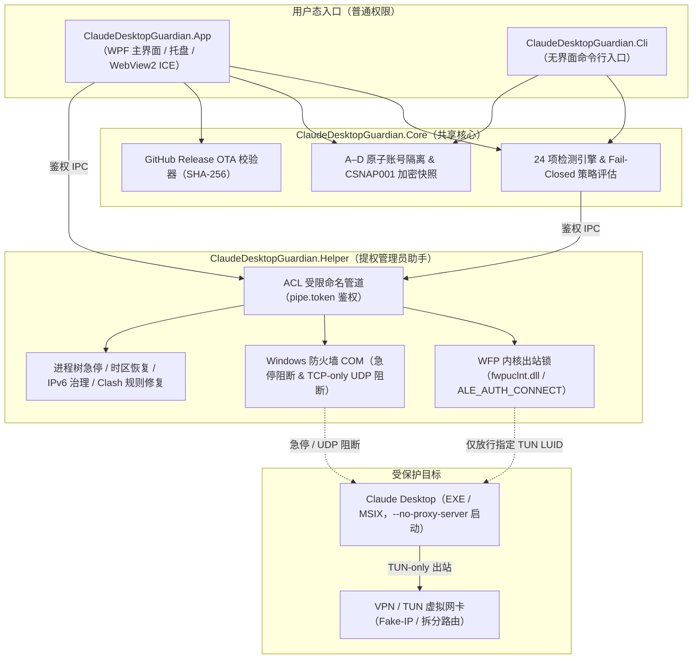

<div align="center">


<h1>claude-damn</h1>

<p><strong>Windows 平台 Claude Desktop 内核级网络守护与多账号安全隔离工作台</strong></p>

<p>
  原生 <code>.NET 8 / WPF</code> &middot; WFP <code>ALE_AUTH_CONNECT</code> 内核锁 &middot; 24 项实时环境体检矩阵 &middot; <code>A–D</code> 原子账号隔离 &middot; GitHub Release OTA
</p>

<p>
  <a href="https://github.com/snowpear-lab/claude-damn/releases"></a>
  <a href="https://github.com/snowpear-lab/claude-damn/actions/workflows/guardian-ci.yml"></a>
  
  
  <a href="https://github.com/snowpear-lab/claude-damn/stargazers"></a>
  <a href="https://github.com/snowpear-lab/claude-damn/releases"></a>
</p>

<p>
  <strong>简体中文</strong> &middot;
  <a href="./README.en.md">English</a> &middot;
  <a href="./README.ja.md">日本語</a>
</p>

<p>
  <a href="#核心能力">核心能力</a> &middot;
  <a href="#系统架构">系统架构</a> &middot;
  <a href="#24-项环境体检矩阵">24 项体检矩阵</a> &middot;
  <a href="#快速开始">快速开始</a> &middot;
  <a href="#claude-仅走-tun同时保留系统代理">仅走 TUN</a> &middot;
  <a href="#cli-命令行参考">CLI 参考</a> &middot;
  <a href="#构建测试与-ota-更新">构建与更新</a>
</p>

</div>

---

> [!NOTE]
> **claude-damn** 是基于 `.NET 8 / WPF` 原生开发的 Windows Claude Desktop 网络守护与多账号安全工作台（项目名与 GitHub 仓库统一为 `claude-damn`）。通过原生 **Windows Filtering Platform (WFP)** 内核出站锁、Fail-Closed 防火墙急停、24 项环境体检矩阵、`A–D` 多账号事务隔离与 SHA-256 校验 OTA 更新，全面防范 Claude Desktop（兼容传统 EXE 与 MSIX）的真实 IP、IPv6、DNS、路由与 WebRTC 泄露风险。

## 核心能力

### 1. 内核级双层网络防护与 Fail-Closed 门禁

| 防护机制 | 核心说明 |
| :--- | :--- |
| **WFP 内核出站锁 + 防火墙急停双层协同** | 可选启用原生 WFP (`fwpuclnt.dll`) `ALE_AUTH_CONNECT` TUN-only 出站白名单（支持可选放行本机回环以兼容本地 MCP/代理；启用时会主动结束当前用户既有 Claude Desktop 进程并复核退出，避免旧连接绕过内核过滤），支持 **TUN 网卡断开重连后自动重绑 WFP** 并修复 junction 路径重复导致的 `stale` 误报；同时保留异常触发时的幂等 `HNetCfg.FwPolicy2` 防火墙阻断 + 归属校验进程树急停，以及高并发 Helper 命名管道查询。 |
| **Claude TCP-only *(独立设置，默认关闭)*** | 在专用规则组 `ClaudeDesktopGuardian.<SID>.TcpOnly` 下阻断已识别 Claude EXE/MSIX 的全部出站 UDP（所有端口、接口与配置），不包含代理内核。启用、启动恢复与显式修复均验证旧会话退出并读回规则；开启后规则缺失、过期或证据不足均阻止启动，不可被可选检查降级。正常退出与卸载仅清理本用户托管规则，保留开关以便下次启动重建。*（可能影响语音、视频或其他实时功能。）* |
| **Fail-Closed 阻断锁定与安全启动门禁** | 异常触发阻断后持续锁定状态，Claude 退出或 5 秒轻量巡检不会自动解封；阻断期间若 Claude 重新启动会再次强制终止。提供「安全启动 Claude」按钮与托盘入口，仅在未阻断且硬性环境检查全部通过时放行启动（兼容 EXE 与 MSIX）。 |
| **系统代理与 TUN 双路径一致性 & 严格路径门禁** | 检测到系统 HTTP 代理启用时并行探测代理路径与绕过代理的 TUN 路径，面板保留两类证据并在国家或出口分歧时阻断。代理客户端或 VPN/TUN 网卡离线时立即跳过所有外网探针，杜绝真实 IP 直连暴露。 |
| **多代理客户端识别与多源出口兜底** | 支持 `auto` / `Clash Verge` / `FlClash` / `sing-box` / `ClashX` / `Surge` / `WireGuard` / `other`，优先识别 `198.18.*` Fake-IP TUN 与 `0.0.0.0/0` 默认路由。IPv4 出口按 Cloudflare trace → `ipinfo.io` → `ipwho.is` → `api.ip.sb` 兜底；时区支持 `ipapi.co` → `ipinfo.io` → `ifconfig.co` → `ipwho.is` → ICU 国家默认映射兜底。 |
| **双安装态兼容 & 单实例异步防卡死** | 自动发现 `%LOCALAPPDATA%\AnthropicClaude`、`%LOCALAPPDATA%\Programs\Claude` 与 MSIX `WindowsApps\Claude_` 及其 `Claude-Data\<PFN>` 数据目录。互斥锁（`Local\ClaudeDesktopGuardian.SingleInstance`）防双开并唤起已有窗口；后台异步巡检 + 超时保护 + 托盘有序退出，避免检查与退出互相干扰。 |

### 2. 24 项环境体检矩阵与地区自适应

- **核心硬检查 *(永不可跳过/降级)***：代理客户端、VPN/TUN 网卡、目标最佳路由（`default-route`）、出口 IP、IPv6 活动路由表（`::/0`、`2000::/3`、`64:ff9b::/96`）+ 强制 IPv6 出口探针、管理员助手、防火墙保护、WFP 严格模式策略，以及开启后的 TCP-only 策略。
- **目标最佳路由与证据时效**：用具体探测目标及活动连接的 Windows 最佳路由识别拆分默认路由与更具体的物理旁路（自动排除回环/私网/链路本地连接并保留 `198.18.*` 与公网目标，TUN 仅配 ULA IPv6 时不误判阻断），HTTP 直连探针在建连前验证路径。网络上下文变化触发完整检查；相同网卡的出口基线最多 **60 秒** 刷新。每项 `Evidence` 标明实际观测时间 `observed_at`、缓存状态 `cached` 与采集错误 `collection_error`，采集失败或空表不再冒充通过。
- **策略与可选检查 *(支持真单项复检、按项关闭为 `Skip`、可选失败降级为 `Warn`)***：
  - Claude 进程树与活动双栈连接端口策略（放行 TCP `443` 与本机回环，非 443 远端端口告警）
  - 出口 IP 稳定性与 48 小时漂移记录（`iphistory.log`）
  - 真实 `claude.ai` DNS 解析与 Fake-IP 隧道核验
  - 原生 STUN UDP（`stun.cloudflare.com`、`stun.l.google.com`、`stun.miwifi.com`、`stun.chat.bilibili.com`）+ 内置 WebView2 浏览器 ICE 双层 WebRTC 检测（支持 `proxy` / `reject` 策略；确认非 VPN 公网泄露**永不降级**）
  - 出口时区自动同步与退出恢复 + 系统 Locale + Claude 客户端 `config.json` 语言检查
  - **一键重新适配出口地区（`set-region`）**：切换国家节点后一键重新探测出口国家、时区与期望 Locale（拒绝 `CN` 出口）并同步系统时区
  - Clash Verge / FlClash 运行模式与前 16 条内核置顶规则审计（13 个 Claude 相关域名 + 3 个仅 UDP STUN 端口；FlClash 支持自动探测本机监听端口）
  - 出口 ASN 网络类型审计（`ipinfo.io` + `PeeringDB`）与 Claude HTTPS 生态可达性
  - 可插拔 4 项 IP 信誉检测（`IP 纯净度`、`IP 代理标记`、`IP 机房属性`、`IP 黑名单`，仅 HTTPS + `{ip}` 模板或 `?ip=` 参数 + `X-API-Key` 请求头 + 本地 TTL 缓存）

### 3. 多账号事务隔离与加密快照迁移

- **`A–D` 账号槽位隔离切换**：Fail-Closed 环境门禁（阻断锁定或环境检查异常时拒绝切换），采用进程互斥锁（`Local\ClaudeDesktopGuardian.AccountOp`）、`.new`/`.previous` 暂存换位、残留恢复保护和原子指针提交，失败自动回滚；数据独立存储在 `%LOCALAPPDATA%\ClaudeDesktopGuardian\accounts`。
- **跨账号共享路径**：支持 `keep-in-workspace.txt` 白名单，自动拦截绝对路径、`..` 越界与符号链接。
- **`.csnap` 加密快照导出/导入**：完整兼容 `claude-switcher` 的 `CSNAP001` 格式（**PBKDF2-HMAC-SHA256** 200,000 次迭代 + **AES-256-CBC** + **HMAC-SHA256** 先加密后认证 + 防 Zip-Slip 逐项校验解压）。

### 4. 维护工具箱、CLI 入口与脱敏诊断

- **一键修复环境**：经由已提权的管理员助手完成 DNS 缓存刷新、时区同步、仅针对泄漏非 VPN 网卡禁用 IPv6 绑定、按 Clash 模式修复 Clash Verge `Script.js`（自动识别代理组、保留已有 `main`、重启并校验 `/rules`、失败自动回滚）及清理旧 `Merge.yaml`、刷新 WFP 策略。
- **只读体检工具**：设备指纹体检（中文字体/GPU/分辨率/虚拟化特征）、Claude Code CLI 体检、独立代理传输诊断（`diagnose-proxy`，支持 URL 或私有 JSON `--config`，不写客户端日志、不创账号状态，退出码 `0`/`1`/`2`）。
- **一次性安全隔离浏览器**：强制禁用扩展与非代理 UDP（`--force-webrtc-ip-handling-policy=disable_non_proxied_udp`），关闭窗口自动销毁临时配置目录。
- **持久化配置与脱敏诊断包**：`%LOCALAPPDATA%\ClaudeDesktopGuardian\config.json`、512 KiB 自动轮转脱敏日志 `logs\guardian.log` 及一键导出剔除 IP/密钥的诊断 `.zip`。

---

## 系统架构



---

## 24 项环境体检矩阵

<details>
<summary><strong>点击展开完整 24 项环境体检矩阵</strong></summary>

| # | Check ID | 检查名称 | 频率 | 级别 | 通过条件与失败动作 |
| :---: | :--- | :--- | :--- | :--- | :--- |
| 1 | `claude-process` | Claude 进程树 | 5 秒 | 提示 | 识别到当前用户 Claude 进程（未运行记 `Warn`，不阻断） |
| 2 | `proxy-client` | 代理客户端 | 5 秒 | **硬检查** | 目标或自动识别客户端在线；失败阻断并跳过全部外网探针 |
| 3 | `vpn-adapter` | VPN/TUN 网卡 | 5 秒 | **硬检查** | 虚拟网卡 `Up` 且有非 APIPA IPv4；失败阻断并跳过外网探针 |
| 4 | `default-route` | 目标最佳路由 | 5 秒 | **硬检查** | 探测目标及 Claude 活动连接最佳路由均经 TUN（兼容拆分默认路由）；旁路或读取失败阻断 |
| 5 | `egress-ip` | 出口 IP | ≤ 60 秒 / 变化 | **硬检查** | 非 `CN`、匹配目标国家，且系统代理与直连 TUN 路径出口一致 |
| 6 | `ip-consistency` | 出口 IP 稳定性 | 30 分钟 / 手动 | 可选 | 与上次一致且 48h 内不同出口 &lt; 3 个（异常记 `Warn`） |
| 7 | `timezone` | 时区一致性 | 启动 / 30 分钟 | 可选 | Windows 时区匹配出口 IANA 映射，退出/卸载自动恢复原时区 |
| 8 | `locale` | 系统地区 Locale | 30 分钟 / 手动 | 可选 | `CurrentCulture.Name` 与目标 Locale 一致（不一致记 `Warn`） |
| 9 | `dns` | DNS 解析 | 30 分钟 / 变化 | 可选 | 成功采集有效解析，Fake-IP TUN 匹配 `198.18.*`（空/失败记 `Unknown`） |
| 10 | `ipv6` | IPv6 出口 | 30 分钟 / 手动 | **硬检查** | 非 VPN 网卡无 `::/0`、`2000::/3`、`64:ff9b::/96` 路由；公网 IPv6 与 IPv4 同国 |
| 11 | `webrtc` | WebRTC 泄露 | 启动 / 30 分钟 | 可关闭 *(泄露永硬)* | 原生 STUN 与 WebView2 ICE 无非 VPN 公网候选；确认泄露**永不降级** |
| 12 | `active-connections` | 活动连接 | 5 秒 | 策略项 | 成功读取双栈 TCP/UDP；已建立 TCP 仅访问 `443` 或本机回环 |
| 13 | `helper-service` | 管理员助手 | 5 秒 | **硬检查** | 受限命名管道在线且返回有效状态 |
| 14 | `wfp-policy` | WFP 内核出站锁 | 5 秒 | **硬检查** *(严格)* | 严格模式开启时状态为 `active`（`off`/`stale`/`unavailable` 阻断） |
| 15 | `firewall-readiness` | 防火墙保护 | 5 秒 | **硬检查** | `BFE`/`MpsSvc` 正常、活动配置启用、本地策略有效且规则可读 |
| 16 | `clash-rules` | Clash 置顶路由 | 30 分钟 / 手动 | 可选 | 规则模式下内核前 16 条匹配 13 域名 + 3 UDP STUN 及策略目标 |
| 17 | `client-language` | 客户端语言 | 30 分钟 / 手动 | 可选 | Claude `config.json` 的 `locale` 前缀匹配目标（不匹配记 `Warn`） |
| 18 | `asn` | ASN 网络类型 | 30 分钟 / 手动 | 可选 | `ipinfo.io` + `PeeringDB` 确认为 `Cable/DSL/ISP`（其他记 `Warn`） |
| 19 | `claude-domains` | Claude HTTPS | 30 分钟 / 变化 | 可选 | 完整数字响应（`2xx`/`3xx` 正常，预期 API `401` 需认证，`403`/`429` 记 `Warn`） |
| 20 | `ip-rep-score` | IP 纯净度 | 30 分钟 / 手动 | 可选 *(可插拔)* | 自定义 HTTPS 信誉源风险分 &lt; 阈值 |
| 21 | `ip-rep-proxy` | IP 代理标记 | 30 分钟 / 手动 | 可选 *(可插拔)* | 公开代理 / VPN / Tor 三项均为否 |
| 22 | `ip-rep-hosting` | IP 机房属性 | 30 分钟 / 手动 | 可选 *(可插拔)* | 非机房/数据中心地址 |
| 23 | `ip-rep-blacklist` | IP 黑名单 | 30 分钟 / 手动 | 可选 *(可插拔)* | 黑名单命中数为 `0` |
| 24 | `tcp-only-policy` | Claude TCP-only | 5 秒 | **硬检查** *(开启)* | 专用组覆盖当前用户 Claude EXE/MSIX 的全出站 UDP 阻断（关闭时 `Skip`） |

</details>

<details>
<summary><strong>检测语义、WebRTC DNS 预解析与证据边界说明</strong></summary>

- **证据边界**：HTTP `2xx`/`3xx` 表示正常响应，预期 API `401` 表示传输到达但需要认证；`403`/`429`/其他服务错误显示警告，异常字符串与缺失响应显示未验证，它们均不证明账号或消息可用。DNS 只验证解析/Fake-IP 特征；UDP 绑定端点不证明已发送；Guardian WebRTC 探针不等于 Claude 内部测试；规则读回不替代抓包；ASN 判断保留现状；信誉源未配置、缺字段或过期不表示 IP 干净。
- **TCP-only 开关与协同**：在设置中打开「Claude TCP-only」，或通过 CLI 执行 `set-check-config '{"tcpOnlyEnabled":true}'` / `tcp-only-enable` 启用；`tcp-only-status` 只读查询，`tcp-only-disable` 保存关闭并清理本组托管规则（修改策略需已连接新版管理员助手）。启用 TCP-only 只约束 UDP；需要限制 TCP 仅经虚拟网卡时仍应启用并核验 **WFP 严格模式**。
- **WebRTC `701` 告警与 DNS 预解析**：浏览器探测前，普通 `stun:` 域名先通过系统 DNS 解析为地址列表，保留所有返回的 IPv4/IPv6 地址、端口与传输参数，避免浏览器对缺失地址族重复报告解析错误；`stuns:` 与 TURN URL 保持原样；DNS 失败或无结果时保留原始 URL 并继续报告真实错误，不跳过检测。当浏览器 ICE 收集完成、存在匹配 HTTP 出口基准的公网候选、原生 STUN 每项均成功且地址全部匹配出口，且仅剩已由原生探针验证成功的 `701 / STUN host lookup received error` 时，WebRTC 显示非阻断警告「出口一致，存在部分 ICE 解析告警」并保留原始证据；发现非预期公网地址始终判 `Fail`，不能通过忽略或非关键降级放行。

</details>

---

## 快速开始

### 运行环境要求

- **操作系统**：Windows 10 / 11（x64）
- **运行组件**：[Microsoft Edge WebView2 Runtime](https://developer.microsoft.com/en-us/microsoft-edge/webview2/)（用于内置 WebRTC ICE 探测）
- **权限**：安装、卸载及运行管理员助手需管理员权限
- **源码构建**：[.NET 8 SDK](https://dotnet.microsoft.com/download/dotnet/8.0)（可选：Node.js 用于检查 `leak-check.js` 语法）

### 方式一：下载预编译 Release *（推荐）*

1. 前往 [GitHub Releases](https://github.com/snowpear-lab/claude-damn/releases) 下载 `ClaudeDesktopGuardian-<version>-windows-x64.zip` 与 `SHA256SUMS-release.txt`。
2. 在 PowerShell 核对压缩包 SHA-256 校验值：
   ```powershell
   Get-FileHash .\ClaudeDesktopGuardian-*-windows-x64.zip -Algorithm SHA256
   ```
3. 解压后运行 `ClaudeDesktopGuardian.App.exe`（如需注册开机计划任务与桌面快捷方式，推荐使用源码中的 `install.ps1`）。

### 方式二：从源码构建并安装

使用**管理员 PowerShell** 执行安装或卸载：

```powershell
# 默认安装到 D:\Apps\claude-damn（支持 -InstallDir 自定义磁盘路径）
.\install.ps1
.\install.ps1 -InstallDir D:\Apps\claude-damn

# 卸载（先通过 Helper --cleanup-all 清理 WFP、防火墙规则并恢复临时时区，保留用户账号存档）
.\install.ps1 -Uninstall
.\install.ps1 -Uninstall -InstallDir D:\Apps\claude-damn
```

> [!TIP]
> 点击窗口右上角关闭会隐藏到系统托盘；请从托盘菜单选择 **“退出并恢复时区与网络策略”**，以干净恢复原 Windows 时区、清理 `claude-damn` 防火墙规则并移除 WFP 出站锁。

---

## Claude 仅走 TUN，同时保留系统代理

Guardian 的「安全启动 Claude」及切换账号后的自动启动会传入 Electron 支持的 `--no-proxy-server`，使 Claude 绕过 Windows 系统代理并由 TUN 接管连接，Codex 等其他应用仍可继续正常使用系统代理：

- **双安装态参数注入**：传统 EXE 使用独立进程启动参数，MSIX 使用 Windows 应用激活接口传参；传统 EXE 子进程还会移除继承的 `HTTP_PROXY` / `HTTPS_PROXY` / `ALL_PROXY` 环境变量，不修改系统代理或其他应用环境。
- **WFP 内核硬约束协同**：要求严格限定虚拟网卡时，启用 **WFP 严格模式** 并保持 **「允许本机回环」关闭**。启动参数负责绕过代理，WFP 负责拦截非指定 TUN 连接，两者不可相互替代。

> [!IMPORTANT]
> 启动前须先完全退出 Claude（已有实例会拒绝启动，防止单实例转发导致 `--no-proxy-server` 失效）。请始终通过 Guardian 启动；从原快捷方式或开机自启进入的 Claude 不会获得该参数，严格 WFP 会继续阻止它连接本机代理。TUN 之后的代理节点选择仍由 Clash 规则决定。验证时可保留系统代理开启，确认 Claude 主进程含 `--no-proxy-server`、WFP 拦截直连与回环，并在界面验证加载与消息发送。

---

## CLI 命令行参考

`ClaudeDesktopGuardian.Cli.exe` 复用 `ClaudeDesktopGuardian.Core`，适合脚本编排与无界面巡检：

| 命令 | 说明 |
| :--- | :--- |
| `check` / `checkdetail` | 执行完整 24 项检测（输出 `OK`/`FAIL` 摘要或逐项明细） |
| `check-item <check-id>` | 真单项复检并按最小依赖刷新关联项 |
| `status` / `switch <A\|B\|C\|D> [--no-launch]` | 查询当前槽位或执行 Fail-Closed 原子账号切换 |
| `set-region` | 切换节点后重新探测出口国家、时区与期望 Locale |
| `get-client` / `set-client <mode>` | 查看或设置代理客户端模式（`auto` / `clash-verge` / `flclash` / `sing-box` / `clashx` / `surge` / `wireguard` / `other`） |
| `get-flclash-controller` / `set-flclash-controller <port\|127.0.0.1:port\|auto>` | 查看或配置 FlClash 本机控制端口 |
| `tcp-only-enable` / `tcp-only-status` / `tcp-only-disable` | 启用、查询或关闭 Claude 专用出站 UDP 阻断规则 |
| `rules-status` / `fingerprint` / `cli-info` | 审计 Clash 置顶规则、设备指纹特征与 Claude Code CLI 环境 |
| `open-safe <http(s)://url>` | 启动禁用扩展与非代理 UDP 的一次性安全隔离浏览器 |
| `diagnose-proxy [--proxy <url> \| --config <file.json>]` | 独立代理传输诊断（零状态副作用，退出码 `0`/`1`/`2`） |
| `snapshot-export <A\|B\|C\|D> <file.csnap>` | 导出 `CSNAP001` 加密快照 *（密码经 stdin 传入）* |
| `snapshot-import <file.csnap> <A\|B\|C\|D>` | 导入 `CSNAP001` 加密快照 *（密码经 stdin 传入）* |
| `get-check-config` / `set-check-config '<json>'` | 读取或更新检查策略配置（`tcpOnlyEnabled`、`disabled`、`webrtcPolicy`、`ipReputation` 等） |
| `export-diagnostics <file.zip>` | 导出剔除 IP、API Key 与账号敏感信息的脱敏诊断包 |

---

## 构建、测试与 OTA 更新

### 本地构建与回归测试

```powershell
# 运行核心与 WPF/Dispatcher/命名管道回归测试
dotnet run --project tests\ClaudeDesktopGuardian.Tests.csproj -c Release

# 分模块构建
dotnet build src\ClaudeDesktopGuardian.Core\ClaudeDesktopGuardian.Core.csproj -c Release
dotnet build src\ClaudeDesktopGuardian.Helper\ClaudeDesktopGuardian.Helper.csproj -c Release
dotnet build src\ClaudeDesktopGuardian.App\ClaudeDesktopGuardian.App.csproj -c Release
dotnet build src\ClaudeDesktopGuardian.Cli\ClaudeDesktopGuardian.Cli.csproj -c Release

# 校验 WebRTC 脚本语法
node --check src\ClaudeDesktopGuardian.App\web\webrtc\leak-check.js
```

执行完整发布构建（含全量测试、JS 语法检查、PowerShell UTF-8 BOM/AST 校验及共享单目录自包含发布，产物位于 `publish\win-x64`，总体积约 **164 MB**）：

```powershell
.\build.ps1
```

开发阶段可先启动管理员助手，再启动 WPF 主程序：

```powershell
dotnet run --project src\ClaudeDesktopGuardian.Helper\ClaudeDesktopGuardian.Helper.csproj
dotnet run --project src\ClaudeDesktopGuardian.App\ClaudeDesktopGuardian.App.csproj
```

*回归测试包含独立 STA / WPF Dispatcher 验证（确保完整、轻量与单项检查执行期间仍能响应界面操作且 WebView2 留在界面线程），以及基于随机本机测试管道的 Clash TUN 诊断回归（不触碰真实代理或系统设置）。*

### GitHub Release 自动更新（OTA）

- Guardian 启动后会只读检查 GitHub 正式 Release，也可以在主窗口点击「检查更新」。
- 安装更新前会下载共享运行目录压缩包、核对 `SHA256SUMS-release.txt` 中的 **SHA-256**，并请求管理员确认；确认后先恢复时区与网络策略，再原子替换程序文件。
- 更新失败会自动回滚，旧程序目录作为 `.rollback.<事务号>` 保留；账号存档、配置与运行状态位于 `%LOCALAPPDATA%\ClaudeDesktopGuardian`，不随 OTA 替换。
- 推送 `guardian-vMAJOR.MINOR.PATCH` 标签即可触发 [`.github/workflows/guardian-release.yml`](./.github/workflows/guardian-release.yml)，自动生成 Windows x64 zip 与 SHA-256 清单。

> [!WARNING]
> 若旧版卡在检查且重复打开仍无响应，单实例互斥机制会继续唤起同一个旧进程。更新时需先结束旧实例，再启动新版程序；维护者部署前建议保留原安装目录备份。

---

## 目录结构

```text
claude-damn/
├── src/
│   ├── ClaudeDesktopGuardian.App/      # WPF 主程序、系统托盘、WebView2 ICE 探测与程序图标
│   ├── ClaudeDesktopGuardian.Core/     # 24 项检测引擎、WFP/路由/网络探测、A–D 账号、CSNAP001、OTA
│   ├── ClaudeDesktopGuardian.Helper/   # 提权命名管道助手（WFP、防火墙 COM、TCP-only、一键修复）
│   └── ClaudeDesktopGuardian.Cli/      # 复用核心库的命令行工具
├── tests/                              # 自动化回归测试（STA/Dispatcher、合成网络/防火墙/管道）
├── docs/                               # 详细评测文档与验收基线
├── .github/workflows/                  # CI（guardian-ci.yml）与标签发布（guardian-release.yml）
├── build.ps1                           # 完整验证与共享运行时发布脚本
├── install.ps1                         # 管理员安装与清理卸载脚本
├── apply-update.ps1                    # SHA-256 校验 OTA 替换与回滚脚本（UTF-8 BOM）
└── THIRD_PARTY_NOTICES.md              # 第三方开源组件说明
```

---

## 文档、参考项目与致谢

### 项目文档
- **全功能清单与快速上手指南**：[`docs/使用指南.md`](./docs/使用指南.md)
- **详细评测与规格说明**：[`docs/评测文档.md`](./docs/评测文档.md)
- **第三方开源组件声明**：[`THIRD_PARTY_NOTICES.md`](./THIRD_PARTY_NOTICES.md)

### 参考项目与致谢
- [**YOURSJEYO/claude-switcher**](https://github.com/YOURSJEYO/claude-switcher) — 本项目的上游灵感与核心设计参考来源，参考并兼容了其 Windows CLI 命令接口、`A–D` 多账号隔离槽位、`keep-in-workspace.txt` 共享白名单、Clash 置顶规则约定以及 `.csnap`（`CSNAP001`）加密快照二进制格式。
- [**MyIPScan/leak-check**](https://github.com/MyIPScan/leak-check)（`@myipscan/leak-check` `1.0.4`，MIT）— 本项目内置 WebView2 浏览器端 WebRTC 候选地址收集逻辑基于该开源项目调整实现，详情见 [`THIRD_PARTY_NOTICES.md`](./THIRD_PARTY_NOTICES.md)。
